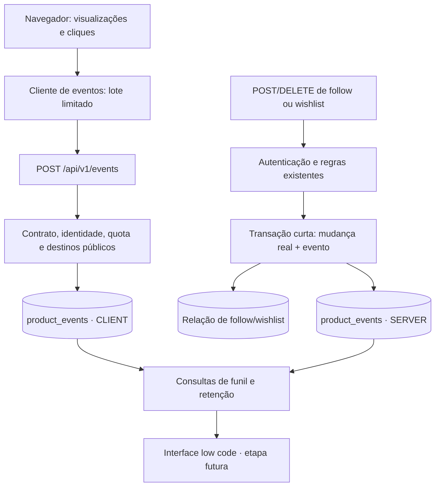

# Plano — eventos de produto no banco do Manifold

Status: plano aprovado pelo usuário em 19/10/2026; implementação em validação. O estado implementado e os ajustes posteriores de revisão estão em [product-events.md](product-events.md).

Base inspecionada na elaboração do plano: `origin/main`, commit `29a4a2e`, antes de qualquer alteração funcional. O checkout isolado é `.worktrees/product-events`.

## 1. Resultado e limites da primeira versão

Persistir eventos no PostgreSQL próprio para depois consultar jornadas, conversão e retorno por uma interface low code. A primeira versão entrega contrato de eventos, persistência, coleta de navegação pública e integração das ações de seguir Outlet e wishlist.

Incluído:

- Eventos observados no navegador e fatos confirmados pelo servidor, identificados separadamente.
- Correlação por conta autenticada e visita anônima limitada, sem usar tokens de login como identificadores de analytics.
- Ingestão em lotes pequenos, deduplicação e proteção do endpoint público.
- Testes HTTP → regras de negócio → PostgreSQL, incluindo concorrência e falhas.
- Documentação dos eventos e consultas de exemplo para a futura visualização.

Etapas posteriores: painel, ferramenta low code, notificações, sincronização Steam/VPS, armazenamento analítico separado e ampliação para checkout/financeiro. Este trabalho não cria uma lista de desejos nova para jogos que hoje usam a wishlist externa da Steam.

Os novos eventos de produto vão somente ao banco próprio. Não será instalado SDK de analytics de terceiros. A instrumentação Vercel existente será inventariada; a migração do funil de criadores para o transporte próprio ficará em uma etapa separada, sem ampliar os dados enviados ao transporte atual.

## 2. O que já existe e afeta o desenho

| Superfície atual                                             | Consequência para o plano                                                                                                   |
| ------------------------------------------------------------ | --------------------------------------------------------------------------------------------------------------------------- |
| `models/store_follow.ts` trata duplicação como sucesso       | Um HTTP 201 não prova que houve um novo follow. O evento nasce apenas na criação efetiva da relação.                        |
| `models/wishlist.ts` usa upsert com atualização vazia        | Uma tentativa repetida não pode produzir uma segunda adição no funil.                                                       |
| Wishlist rejeita jogos `ONLY_DISPLAY`                        | Link para a Steam mede saída para loja; não confirma adição à wishlist externa.                                             |
| GET de seleção atende SSR e gerador Open Graph               | O GET não grava visualização. A observação nasce no navegador após renderização pública.                                    |
| Há preview privado de Outlet/seleção                         | Preview e superfícies privadas ficam fora da coleta pública inicial.                                                        |
| `StoreLifecycleEvent` já registra auditoria de publicação    | Preservar a auditoria existente; a tabela de produto não substitui eventos operacionais/de domínio já existentes.           |
| `lib/creator-funnel-analytics.ts` já define eventos fechados | Reaproveitar o padrão de contrato e transporte isolado; não misturar evento observado com confirmação autoritativa.         |
| O rate limiter de autenticação é um `Map` local              | Ele não fornece um limite compartilhado entre instâncias Vercel. Não será apresentado como proteção distribuída do coletor. |
| Helpers de login usam `Set-Cookie` simples                   | Acrescentar cookies analíticos exige preservar o cookie de autenticação e os demais cabeçalhos.                             |
| IDs de domínio usam referências lógicas sem FK               | Seguir essa convenção, preservando eventos históricos sem exclusão em cascata.                                              |

## 3. Fluxos de gravação



Não há chamada HTTP da aplicação para ela mesma para gravar um fato confirmado. Os models usam diretamente o escritor de eventos com o mesmo cliente de transação.

## 4. Models e armazenamento

### 4.1 `ProductEvent` → `product_events`

Uma tabela append-only de eventos: a aplicação insere, sem disponibilizar edição, leitura pública ou exclusão pública.

| Campo proposto       | Tipo PostgreSQL                                     | Uso                                                                                                                      |
| -------------------- | --------------------------------------------------- | ------------------------------------------------------------------------------------------------------------------------ |
| `id`                 | `bigint generated always as identity`               | Chave sequencial interna; cursor de leitura, sem UUID aleatório na chave primária de alto volume.                        |
| `event_key`          | `text`, único; limite de 160 caracteres no contrato | Deduplicação de uma ocorrência, preservada nos retries.                                                                  |
| `name`               | `text`                                              | Nome validado pelo catálogo de eventos; não usar enum de banco para exigir migration a cada evento novo.                 |
| `schema_version`     | `smallint`, positivo                                | Versão do payload daquele nome de evento.                                                                                |
| `source`             | `text` com CHECK `CLIENT`/`SERVER`                  | Autoridade da origem; definida pelo servidor.                                                                            |
| `occurred_at`        | `timestamptz(3)`                                    | Hora do servidor na ocorrência de domínio; na coleta CLIENT, hora de recebimento usada como referência canônica inicial. |
| `received_at`        | `timestamptz(3)`, default do banco                  | Recebimento para ordenação e operação da coleta.                                                                         |
| `client_occurred_at` | `timestamptz(3)`, nullable                          | Hora alegada pelo navegador, com janela de validade; nunca autoridade para login ou confirmação da ação.                 |
| `user_id`            | `text`, nullable                                    | Obtido exclusivamente do contexto de autenticação do servidor.                                                           |
| `anonymous_id`       | `uuid`, nullable                                    | Identificador first-party de navegador; não significa pessoa única.                                                      |
| `visit_id`           | `uuid`, nullable                                    | Visita analítica, distinta da sessão de autenticação.                                                                    |
| `store_id`           | `text`, nullable                                    | Outlet resolvida/confirmada no servidor.                                                                                 |
| `selection_id`       | `text`, nullable                                    | Seleção pública resolvida no servidor.                                                                                   |
| `game_id`            | `text`, nullable                                    | Jogo público ou jogo validado pela operação de domínio.                                                                  |
| `properties`         | `jsonb`, default `{}`                               | Complementos pequenos, fechados e versionados por evento.                                                                |

O campo `id` não será serializado como `number` JavaScript; quando for exposto para leitura interna futura, será string. Verificar a representação de identity/autoincrement aceita pelo Prisma e o SQL gerado antes de fechar a migration.

Regras:

- Exigir `user_id` em fatos de follow/wishlist. Telemetria anônima exige contexto analítico válido emitido pelo servidor.
- Não armazenar email, senha, OTP, token de sessão, cookie completo, IP bruto, descrição livre, URL completa, query string ou mensagem de erro dentro do evento.
- Campos normalizados servem para joins no low code. `properties` não substitui identidade nem vira um JSON arbitrário enviado pelo cliente.
- Referências inexistentes ou privadas não são aceitas pela ingestão pública. Exclusão posterior de uma entidade não elimina os fatos históricos automaticamente.

Índices iniciais, sujeitos a EXPLAIN com dados representativos:

1. UNIQUE em `event_key`.
2. B-tree em `(name, occurred_at)` para contagens por evento e período.
3. B-tree em `(user_id, occurred_at)` para jornadas autenticadas.
4. B-tree em `(anonymous_id, occurred_at)` para investigar visitas anônimas delimitadas.
5. B-tree em `received_at` para consultas por período e manutenção da retenção.

Avaliar `(visit_id, occurred_at)` no EXPLAIN do funil. Se necessário, comparar sua utilidade com os índices anteriores e substituir um índice de pouco uso; não acrescentar todos preventivamente.

Não criar GIN para todo o JSONB, índices para cada propriedade, particionamento ou tabelas de agregação neste primeiro momento. Medir o custo total dos índices antes de acrescentar outros.

### 4.2 `ProductEventIngestBucket` → `product_event_ingest_buckets`

Tabela operacional curta para proteger a ingestão pública sem contratar um serviço adicional. Ela não faz parte do modelo de comportamento consultado pelo low code.

- Chave composta: `bucket_key` + `window_start`.
- `event_count` inteiro não negativo e `expires_at` indexado.
- Até três reservas por batch: identidade analítica/conta, HMAC de endereço confiável e orçamento global.
- Contagem por janela atualizada atomicamente com UPSERT condicional. Se a quota não comportar o lote, responder 429 com `Retry-After`, sem inserir eventos desse lote.
- Limite considera eventos tentados, inclusive retries, para não permitir flood de duplicatas.
- Reservar e COMMITAR a quota em transação curta própria ANTES de consultar alvos públicos ou inserir eventos. Rejeição semântica posterior — nome desconhecido, destino inválido ou falha de persistência — não devolve a quota. As reservas de um lote usam ordem fixa de buckets para limitar disputa por locks.
- Primeiro rejeitar de forma barata origem, content type, tamanho, JSON e envelope estrutural impossível. Só depois consumir quota e validar o catálogo/payload específico. Esses rejeitados antes do parser/envelope não geram escrita de quota; a proteção volumétrica da hospedagem continua necessária e não é substituída por essa tabela.
- Bootstrap e tentativas de contexto inválido também consomem orçamento por endereço confiável/global; o orçamento de identidade só é usado quando há contexto validado. A operação de bootstrap custa uma unidade.
- Não confiar em um `x-forwarded-for` arbitrário. A implementação precisa documentar e testar a origem confiável do endereço no proxy/hospedagem; onde não for possível comprová-la, não alegar proteção por IP.
- O HMAC usa segredo próprio, não a chave de autenticação, e não armazena o IP bruto. Buckets expiram e são removidos em lotes limitados.
- O bucket global pode gerar contenção: aceitável apenas dentro do envelope medido do MVP. Ele não é uma promessa de escala ilimitada.

Os limites concretos de eventos/minuto por identidade, endereço e global serão configurações documentadas, dimensionadas no ensaio de carga. Sem segredo/contexto confiável, a coleta CLIENT permanece desabilitada; os eventos SERVER não passam por esse coletor.

## 5. Divisão por arquivos e responsabilidades

| Camada / arquivo proposto                   | Responsabilidade                                                                                                                        |
| ------------------------------------------- | --------------------------------------------------------------------------------------------------------------------------------------- |
| `contracts/product-events.ts`               | Nomes, versões, schemas Zod, origem permitida, payload por evento, limites de batch/propriedades.                                       |
| `models/product_event.ts`                   | Normalizar e persistir eventos; deduplicação; aceitar `Prisma.TransactionClient` para fatos atômicos. Sem dependência de React ou HTTP. |
| `models/product_event_ingest.ts`            | Validar lotes CLIENT, resolver destinos públicos distintos em lote, reservar quotas e fazer inserção limitada.                          |
| `infra/product_event_context.ts`            | Ler/emitir cookies analíticos, derivar usuário da requisição e compor cabeçalhos sem apagar autenticação.                               |
| `models/store_follow.ts`                    | Gravar eventos SERVER somente na transição efetiva, dentro da transação da relação.                                                     |
| `models/wishlist.ts`                        | Mesmo tratamento para adição/remoção elegível da wishlist interna.                                                                      |
| `pages/api/v1/events/index.ts`              | Ingestão POST: tamanho, content type, origem, contexto, validação e resposta. Sem GET/listagem pública.                                 |
| Rotas atuais de follow/wishlist             | Preservar autenticação, permissões, payload e respostas existentes; fornecer contexto de eventos aos models.                            |
| Helpers/rotas de autenticação               | Delimitar a visita no login/logout/troca de conta sem apagar cookies existentes ou registrar credenciais.                               |
| `lib/product-events-client.ts`              | Transporte first-party, fila curta em memória, UUID estável por ocorrência, flush e retry limitado.                                     |
| `components/analytics/ProductPageEvent.tsx` | Um evento por navegação pública renderizada/visível; deduplicar efeitos React e excluir previews.                                       |
| Páginas públicas e `PurchaseCard.tsx`       | Fornecer destinos públicos renderizados e registrar saída para loja externa. Não esperar analytics para navegar.                        |
| `docs/product-events.md`                    | Catálogo implementado, semântica, consultas de exemplo e limites de interpretação.                                                      |

## 6. Primeiros eventos e rotas

### 6.1 Observações do navegador — `source = CLIENT`

| Evento v1                | Onde nasce                                         | Dados específicos                                                                   |
| ------------------------ | -------------------------------------------------- | ----------------------------------------------------------------------------------- |
| `public_page_viewed`     | `/` e `/store` públicos                            | `page_kind` fechado (`home`/`catalog`), locale e superfície de entrada normalizada. |
| `outlet_viewed`          | `/store/[slug]` público                            | Outlet pública renderizada.                                                         |
| `selection_viewed`       | `/store/[slug]/selections/[selectionSlug]` público | Outlet, seleção e revisão publicada resolvidas.                                     |
| `game_viewed`            | `/item/[slug]` público                             | Jogo; contexto de Outlet apenas quando validado, separado de atribuição causal.     |
| `external_store_clicked` | Link externo no `PurchaseCard`                     | Jogo e provedor permitido; significa clique/saída, não compra nem wishlist externa. |

Regras de visualização:

- Emitir após hidratação de conteúdo público válido e documento visível, sem contar SSR, GET da API, Open Graph, prefetch ou preview privado.
- Não usar scroll/timer contínuo, movimentos de mouse, texto digitado ou session replay no MVP.
- Não criar um evento `returned` enviado pelo navegador: retorno será calculado por visitas distintas e datas do servidor.
- Uma renderização não equivale a leitura completa nem a interesse confirmado. Bots continuam uma limitação da métrica CLIENT.

### 6.2 Fatos de domínio — `source = SERVER`

| Evento v1           | Rota existente                 | Condição para uma ocorrência                            |
| ------------------- | ------------------------------ | ------------------------------------------------------- |
| `outlet_followed`   | POST `/api/v1/store-follows`   | Relação realmente criada para usuário autenticado.      |
| `outlet_unfollowed` | DELETE `/api/v1/store-follows` | Relação existente realmente removida.                   |
| `game_wishlisted`   | POST `/api/v1/wishlists`       | Item realmente criado, respeitando elegibilidade atual. |
| `game_unwishlisted` | DELETE `/api/v1/wishlists`     | Item existente realmente removido.                      |

Uma requisição repetida pode continuar retornando o sucesso atual sem produzir novo evento. Remover e adicionar novamente são ocorrências distintas, com chaves baseadas nas instâncias das relações.

O browser não pode emitir esses quatro nomes no coletor, nem mesmo estando autenticado. Ele também não envia `user_id`, `source` ou IDs de uma transação confirmada.

Sem ampliar o escopo: não começar a medir compra, wishlist Steam ou sucesso de terceiros a partir de um clique. A saída para a loja externa tem seu próprio evento observado.

## 7. Falhas, transações e idempotência

### Decisão recomendada para os fatos SERVER

Mudança real da relação + evento na mesma transação PostgreSQL. Essa é uma escolha de consistência: se a gravação do evento falhar, a ação sofre rollback e o endpoint retorna erro. Não prometer simultaneamente captura sem lacunas e independência total da falha de analytics.

- Detectar a transição no próprio INSERT/DELETE/RETURNING ou operação equivalente, não por um `find` externo seguido de escrita sujeita a corrida.
- A chave do evento usa nome + identidade da ocorrência/relação. Não derivar apenas de usuário+jogo: isso apagaria ciclos legítimos de remover e adicionar.
- Retries concorrentes da mesma ação deixam uma relação e um evento, preservando o comportamento idempotente atual.
- Não capturar um erro de INSERT no meio de uma transação PostgreSQL e continuar como se ela estivesse utilizável. Tratar o erro fora da transação ou usar uma operação sem conflito que não a aborte.
- Nenhuma chamada externa, envio de email ou espera de rede dentro da transação.
- Eventos SERVER podem ter apenas `user_id` e contexto de domínio; uma ação válida não exige que o navegador tenha enviado analytics ou possua cookie analítico.

Se o usuário preferir que analytics nunca possa falhar uma ação, a alternativa é gravação best-effort pós-commit, assumindo lacunas. Essa alternativa muda a garantia e os testes; não será adotada silenciosamente.

### Observações CLIENT

- Best-effort. Falha de coleta não bloqueia página, link, wishlist ou follow.
- Cada ocorrência tem UUID criado uma vez; o retry reutiliza o UUID. O servidor reconstrói a chave com namespace CLIENT.
- UNIQUE de `event_key` impede duplicatas mesmo com duas instâncias gravando ao mesmo tempo. Reenvio não altera usuário, entidade ou payload de uma ocorrência já persistida.
- Deduplicar o efeito React de uma navegação; uma visita posterior legítima recebe nova ocorrência.
- Perdas por bloqueio de scripts, fechamento do navegador ou falha de rede permanecem possíveis e precisam constar na interpretação do funil.

### Tempo do evento e ordem da jornada

`occurred_at`/`received_at` preservam a referência do servidor. O envio em lote pode fazer uma visualização chegar depois de um follow que ocorreu após ela. Para o funil, estimar a ordem com `client_occurred_at` validado nas observações CLIENT e com `occurred_at` nos fatos SERVER; na ausência do tempo do cliente, usar o recebimento e declarar a ordem como incerta. Não reescrever o timestamp do servidor nem apresentar o relógio do navegador como prova autoritativa. Testar uma view capturada antes da ação, mas recebida depois dela, com geração ainda válida.

## 8. Identidade, login e retorno

Proposta: identificador first-party de navegador com validade de 90 dias; visita com 30 minutos de inatividade e duração máxima de 24 horas. Cookies emitidos/validados no servidor, separados de `session_id`, com `HttpOnly`, `SameSite=Lax` e `Secure` em produção. Os prazos são parâmetros propostos para revisão.

1. Inicializar o contexto com um envelope de bootstrap no mesmo POST `/api/v1/events`: emitir/validar cookies e devolver uma geração opaca, sem gravar eventos. O SDK só captura ocorrências atribuíveis depois de reconhecer essa geração. Há uma chamada inicial adicional; visitas muito curtas podem se perder.
2. `user_id` sempre vem de `req.context.user`, nunca do body ou de um cookie analítico alegando identidade autenticada.
3. Na primeira autenticação, preservar apenas a correlação da visita anônima ainda ativa e renovar a geração para o novo contexto autenticado. Os novos eventos levam o usuário autenticado; os eventos antigos não são reescritos. Login pode entregar a geração por cabeçalho de resposta, preservando o JSON funcional existente; se o SDK não a receber, precisa fazer novo bootstrap.
4. No logout, troca de conta ou expiração da visita, delimitar novo contexto. Não associar retrospectivamente todo o histórico de um navegador a uma conta.
5. Uma visita com mais de uma conta autenticada não deve ser usada para atribuição individual do trecho anônimo. Definir essa exclusão nas consultas e cobri-la em teste.
6. Renovação da mesma sessão (`GET /api/v1/user`) não é novo login nem nova pessoa. Cobrir senha, OTP, ativação e logout nos pontos reais que emitem/limpam cookies.
7. Preservar todos os valores de `Set-Cookie`. A camada de eventos não pode substituir nem vazar o cookie/token de autenticação.
8. Cada ocorrência guarda a geração reconhecida na captura. Só agrupar eventos da mesma geração. O servidor exige correspondência entre a geração enviada, o cookie assinado, sua validade e a conta atual; geração ausente ou obsoleta responde 409, sem gravar evento ou atribuir identidade/visita da conta atual.
9. No 409, descartar o lote antigo e reinicializar o contexto para ocorrências futuras. Não reutilizar as ocorrências antigas depois do bootstrap. Limpar buffer no login/logout e avisar outras abas reduz perdas, mas o bloqueio no servidor é a garantia para retries e abas desatualizadas.
10. Contexto analítico ausente ou inválido em uma mutation funcional apenas omite esse contexto opcional: não bloqueia follow/wishlist válido, cujo `user_id` vem da autenticação. A transação do evento SERVER continua seguindo a política de falhas da seção 7.

Essa correlação identifica conta/navegador/visita, com limitações em aparelhos compartilhados e perda de cookies. Não mede uma pessoa anônima com certeza nem resolve navegação entre dispositivos sem login.

## 9. Contrato front-end → back-end

Novo endpoint: POST `/api/v1/events`, same-origin, JSON, com dois envelopes fechados: bootstrap de contexto sem eventos e ingestão de batch. Batch máximo proposto de 10 eventos e body de 16 KiB. `properties` de cada evento fica limitado a 1 KiB, além do schema específico fechado.

O bootstrap recebe `{ "type": "bootstrap" }` e devolve somente contexto opaco/validade, com os cookies protegidos. Ele não grava observações antigas, não altera fatos históricos e não devolve credenciais de login. A ingestão recebe a geração reconhecida na captura:

Exemplo conceitual de entrada:

```json
{
  "type": "events",
  "context_generation": "opaque-server-issued-generation",
  "events": [
    {
      "id": "49d58556-4445-4a6a-9908-6d46f3a0cf13",
      "name": "selection_viewed",
      "schema_version": 1,
      "client_occurred_at": "2026-10-19T12:00:00.000Z",
      "target": {
        "store_slug": "example-outlet",
        "selection_slug": "weekend-games"
      },
      "properties": {
        "locale": "pt-BR",
        "entry_surface": "selection_page"
      }
    }
  ]
}
```

O back resolve slugs em IDs públicos, acrescenta contexto/autoria/horários e grava `source=CLIENT`. Não aceitar nomes desconhecidos, versão desconhecida, chaves adicionais, timestamps fora da janela proposta de cinco minutos para trás/trinta segundos para frente, campos livres ou IDs de ator enviados pelo browser. `client_occurred_at` é opcional.

Fluxo do transporte:

1. Buffer em memória de até 50 eventos, com uma requisição em voo por cliente. Não criar backlog offline ilimitado.
2. Flush em até dois segundos, ao atingir dez eventos e ao ocultar/sair da página. Cliques externos acionam flush sem aguardar sua resposta para navegar.
3. Usar `fetch` com `credentials: same-origin` e `keepalive` onde couber. O transporte não depende de SDK externo.
4. Uma nova tentativa com a mesma ocorrência e geração para falhas temporárias. Não insistir em 400/403/413; no 409, descartar o lote e fazer bootstrap para eventos futuros; respeitar 429/Retry-After e o limite do buffer.
5. Responder 200 somente após a gravação/deduplicação concluir, com contagens aceitas/duplicadas; não fingir persistência usando 202 sem fila durável.
6. Lote inválido é rejeitado integralmente, sem escrita parcial de eventos. A quota já confirmada não é revertida. Retornar erro genérico para alvo privado/inexistente, sem revelar seus dados.
7. Responses privadas `no-store`; não criar GET para exportar eventos. Same-origin e content type ajudam no controle de origem, mas não substituem autenticação ou proteção contra automação.

Fatos SERVER usam os endpoints funcionais atuais e o writer interno. Eles não precisam de uma chamada do front a `/events`.

## 10. Performance e operação

- Sem gravações em GETs de conteúdo, SSR, sitemap, OG ou prefetch. Isso preserva cache e evita contar crawler como pessoa.
- Resolver destinos distintos do batch em consultas de conjunto por tipo; não buscar o mesmo jogo ou Outlet para cada evento e não executar pricing/importação externa só para validar um alvo.
- Um batch tem até três consultas de resolução no total, uma por tipo de destino distinto, até três operações de quota, uma escrita em lote de eventos e o contexto de autenticação necessário. Instrumentar a contagem real; evitar N+1 escondido na autorização. O bootstrap é uma chamada inicial separada, sem consultas de destinos nem escrita de eventos.
- Ações confirmadas acrescentam uma escrita pequena de evento na transação, sem HTTP interno. Medir mudança de latência comparando o mesmo cenário com coleta desligada/ligada.
- Reutilizar o cliente Prisma existente. Não abrir um pool por evento, navegador ou request.
- Features separadas para coleta CLIENT e fatos SERVER permitem rollout gradual e interrupção da coleta ruidosa sem desativar a navegação. Desativar um writer confirmado abre uma lacuna de medição, que deve ser registrada operacionalmente.
- O orçamento global de ingestão é um ponto de contenção conhecido. Medir concorrência e lock wait; se dominar a latência, rever a estratégia antes de aumentar o teto, sem simplesmente multiplicar workers.
- Contadores operacionais agregados: aceitos, duplicados, inválidos, limitados e falhas. Não registrar payloads/identificadores completos nos logs.
- Retenção proposta: 90 dias de eventos brutos, configurável e sujeita à aprovação. Remoção de eventos e buckets em lotes curtos, nunca um DELETE gigante no caminho da requisição. Definir o executor de manutenção antes de habilitar coleta; não depender de uma VPS ainda não provisionada para o projeto.
- Relatórios futuros usarão períodos e paginação. O front público não recebe queries analíticas pesadas.

Ensaio proposto, não promessa de capacidade: 100 mil eventos sintéticos, comparação de planos das consultas do funil e uma carga de 50 requests concorrentes, com lotes de até dez. Executar em banco local/isolado, registrar ambiente, throughput, p50/p95, queries por batch, espera por lock e tamanho de tabela/índices. Só então definir quotas de produção. Não usar dados ou tráfego real de produção para o teste.

## 11. Plano de testes

### 11.1 Integração HTTP → aplicação → banco

Usar a infraestrutura já existente de Next + PostgreSQL, `tests/orchestrator.js`, fixtures de Outlet publicada e as suítes atuais de follow/wishlist. Os casos observam linhas no banco, não apenas mocks de `track()`.

| Grupo                  | Casos e resultado esperado                                                                                                                                                                                                             |
| ---------------------- | -------------------------------------------------------------------------------------------------------------------------------------------------------------------------------------------------------------------------------------- |
| Ingestão anônima       | Bootstrap válido emite contexto, sem linha de evento; lote posterior da geração reconhecida grava CLIENT. Nada exige cadastro e cookies não expõem credenciais.                                                                        |
| Ingestão autenticada   | Conta vem da sessão real. `user_id`, `source`, nomes SERVER e campos extras enviados no body são rejeitados.                                                                                                                           |
| Contrato e limites     | Nomes/versões inválidos, body grande, batch grande, propriedades grandes, timestamp inválido e origem externa não geram linhas parciais.                                                                                               |
| Alvos públicos         | IDs/slugs falsos, Outlet não publicada, seleção retirada e preview privado não geram eventos públicos ou divulgação de dados.                                                                                                          |
| Deduplicação           | Mesmo UUID em sequência e em requests concorrentes persiste uma ocorrência. Retry não muda autor nem payload já gravado.                                                                                                               |
| Quotas                 | Requests em paralelo de dois consumidores/instâncias compartilham o mesmo limite no PostgreSQL; 429 tem Retry-After e não grava o lote. Validar proxy confiável e impossibilidade de liberar quota falsificando um header de IP comum. |
| Quota após rejeição    | Nome/destino inválido ou falha de INSERT posterior à reserva mantém o consumo confirmado; repetir a tentativa esgota a quota. Rejeições estruturais anteriores ao parser não abrem transação de quota.                                 |
| Follow                 | Novo follow gera um SERVER; repetição e três requests simultâneos não supercontam. DELETE repetido não gera remoção fictícia; remover e seguir novamente gera novo ciclo legítimo.                                                     |
| Wishlist               | Mesma matriz de criação, remoção e corrida; jogo ONLY_DISPLAY continua rejeitado pela wishlist interna e não gera `game_wishlisted`.                                                                                                   |
| Permissões             | Usuário anônimo, desativado ou sem feature mantém os erros atuais e não produz evento confirmado.                                                                                                                                      |
| Atomicidade            | Forçar falha do INSERT do evento em banco descartável: relação e evento sofrem rollback. Não considerar teste com mock fora da transação uma prova dessa garantia.                                                                     |
| Identidade             | Anônimo → login → follow é correlacionável apenas na visita ativa. Logout/segunda conta abre outro contexto; uma conta não recebe histórico de outra. Renovação da mesma sessão não rotaciona visita.                                  |
| Geração e outras abas  | Lote capturado em A, logout/login B, retry ou segunda aba → 409 e zero eventos. Bootstrap em B só permite novas ocorrências. Lote sem geração não recebe `user_id`, `visit_id` nem `anonymous_id` atuais e não é persistido.           |
| Ordem de recebimento   | View capturada antes e recebida depois do follow conserva os dois tempos; query usa a ordem estimada e sinaliza fallback, sem alegar uma ordem autoritativa para observações CLIENT.                                                   |
| Atribuição do funil    | Duas Outlets/seleções e jogos distintos não se combinam em uma conversão por seleção: exigir Outlet e participação do jogo na revisão publicada observada. Ativação genérica é apurada separadamente.                                  |
| Cookies e autenticação | Senha, OTP, ativação, renovação e logout mantêm seus cookies de autenticação; adicionar cookies analíticos não os sobrescreve. Nunca persistir o token de login em `product_events`.                                                   |
| Falha da coleta CLIENT | Erro/indisponibilidade da ingestão não impede navegação nem chamadas funcionais. Uma ação autenticada sem cookie analítico continua válida e registra o fato com user_id.                                                              |
| Retenção               | Limpeza de eventos e buckets obedece ao cutoff e tamanho de lote; não altera follows/wishlists/usuários nem eventos recentes.                                                                                                          |
| Sem efeitos em GET     | Requests de SSR/API/OG e prefetch não criam eventos de visualização. Não existe endpoint público de leitura dos eventos.                                                                                                               |

Adicionar uma suíte de caso de uso que percorra: bootstrap → seleção publicada → evento CLIENT recebido → login real → nova geração, com a visita ativa preservada → adição elegível à wishlist → follow → visita posterior. Conferir atores, entidades, chaves, correlação e tempos no banco. O caso separado para ONLY_DISPLAY termina em clique externo, sem inventar conversão na Steam.

### 11.2 Testes de cliente e contrato

- Catálogo fechado e compatibilidade de versão; campos desconhecidos e conteúdo sensível rejeitados.
- Bootstrap sem escrita; captura somente após reconhecer geração; buffer limitado, batch por geração, um request em voo, UUID preservado em retry, descarte em troca de contexto/409 e comportamento de 429.
- Efeito React repetido/StrictMode não duplica uma navegação; nova navegação legítima gera ocorrência própria.
- Preview e documento oculto não geram visualização inicial; visibilidade e navegação SPA são exercitadas.
- Clique externo continua navegando quando o coletor falha. Evento não declara sucesso da loja externa.
- Teste em navegador real para observar renderização pública → POST → linha no PostgreSQL e confirmar que o processo não depende de uma aba aberta no painel administrativo.

### 11.3 Migration e regressão

- Migration aditiva em banco descartável; PK/UNIQUE/CHECKs/índices verificados e Prisma gerado com o novo schema.
- Rodar a suíte completa existente, lint, build e checks da PR, não apenas os novos testes.
- Validar o caminho de rollout com migration aplicada e coleta inicialmente desligada. Nenhuma mutation de produção durante a elaboração do plano.

## 12. Consultas e futura visualização low code

Documentar consultas read-only por período, com estes resultados definidos:

1. Alcance: visitas/navegadores/contas distintos que observaram uma seleção. Exibir separadamente o nível de identidade utilizado.
2. Ativação: contas com wishlist interna ou follow confirmado depois de uma observação, dentro de uma janela proposta de sete dias.
3. Funil ordenado de referência: seleção → wishlist → follow, com ligação limitada de visita anônima ativa no login. Medir também wishlist e follow em qualquer ordem para não classificar outro percurso válido como abandono.
4. Retorno: nova visita com evento público depois da visita de ativação. Separar retorno exato no dia 1/dia 7 de retorno em qualquer momento nos sete dias seguintes.
5. Devolução de interesse: remoções de follow/wishlist não apagam o histórico de ativação; número atual vem das tabelas de domínio.

No funil por seleção, exigir follow da mesma Outlet e wishlist de um jogo pertencente à revisão publicada observada; guardar a revisão resolvida no `selection_viewed` e consultar o snapshot histórico. Sem essa relação, chamar a métrica de ativação genérica após exposição, sem atribuir conversão à seleção. A ordem usa o tempo estimado da seção 7, com janela e limitações documentadas; não usar apenas `received_at` nem juntar os três nomes em qualquer data.

O funil é descritivo. Proximidade temporal e pertencimento do jogo não provam que uma seleção causou um follow ou compra. CLI, outras abas, bootstrap, scripts bloqueados e cookies perdidos podem criar jornadas incompletas. Não apresentar contagens CLIENT como uma auditoria de pessoas reais.

No futuro, conectar o low code a uma credencial de leitura restrita a views/colunas necessárias. Não colocar credencial administrativa do banco no browser, não criar um GET público dos eventos e não provisionar o painel/credencial nesta etapa.

## 13. Sequência de implementação, depois da revisão

1. Fechar catálogo v1, política de falhas, identidade e retenção com este plano.
2. Migration aditiva dos dois models e writer interno com testes de deduplicação/transação.
3. Instrumentar follow/wishlist, preservando respostas e autorização existentes.
4. Implementar contexto first-party e integração com os pontos de login/logout/renovação.
5. Implementar endpoint de ingestão, quotas compartilhadas, validação pública em lote e testes de abuso/concorrência.
6. Instrumentar navegação pública e clique externo, com transporte limitado e teste em navegador.
7. Rodar carga local/isolada, consultas do funil, manutenção limitada e toda a regressão.
8. Abrir PR com evidências. Habilitar coleta gradualmente somente depois de verificar a migration e os limites. A interface low code fica para um plano próprio.

## 14. Decisões recomendadas para revisão do usuário

- Dois models: um analítico append-only e um operacional pequeno para quota compartilhada.
- Eventos SERVER na mesma transação: mais consistência, aceitando rollback da ação se o evento falhar.
- CLIENT best-effort, sem garantia de captura integral.
- Preservar apenas a visita ativa no primeiro login; separar logout/troca de conta.
- Bootstrap explícito e geração vinculada por ocorrência, aceitando uma chamada inicial e possíveis perdas em visitas muito curtas para evitar atribuição à conta errada.
- Payload fechado, lotes de dez, 16 KiB por request e 1 KiB de propriedades por evento.
- Retenção bruta proposta de 90 dias, a confirmar antes de habilitar coleta.
- Primeira entrega focada no percurso público e follow/wishlist. Migração do funil de criadores e visualização vêm depois.

## 15. Revisão independente

Revisão independente de desenho realizada pelo subagente `review_product_events_plan`, somente leitura, conforme solicitado pelo usuário. Parecer: adequado ao MVP após incorporar os ajustes abaixo; a implementação continua aguardando a revisão do usuário.

Ajustes incorporados:

- Consumo de quota confirmado antes das consultas semânticas/escrita, sem devolução por lote rejeitado ou falha posterior.
- Bootstrap sem eventos e geração vinculada à captura; rejeição de lote antigo sem reaproveitar a identidade/visita atual, incluindo outras abas e retries.
- Dois tempos preservados, ordem de observações estimada e teste de recebimento invertido.
- Funil por seleção ligado à mesma Outlet e à revisão publicada observada; evitar combinação de jogos/Outlets sem relação.
- Avaliação de índice por visita com EXPLAIN, sem acrescentar índices preventivamente.
- Rollback da ação quando falha o evento SERVER, comportamento explicitado para decisão do usuário.

A revisão não executou testes, migrations ou operações de produção. As suítes descritas neste documento são o plano de validação da futura implementação; não são resultados já obtidos.
