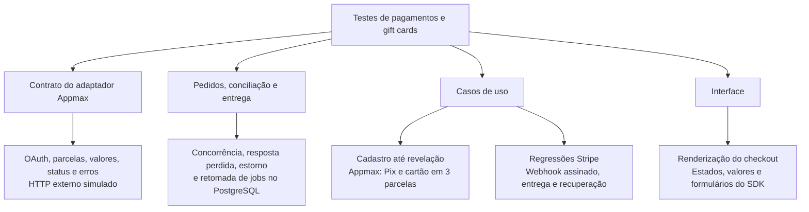

# Casos de uso de integração

Esta pasta reúne jornadas do usuário. Para gift cards, o cenário completo parte
de um cadastro novo; não depende de uma conta pronta nem de credenciais externas.

## Cobertura de pagamentos



- `tests/unit/infra/appmax_payments.test.ts`: contrato do adaptador, com transporte
  HTTP substituído por respostas controladas.
- `tests/integration/models/purchase_payments.test.ts`: transações reais de pedidos,
  confirmação, entrega e jobs, com provedor injetado pelo teste.
- `gift-card-purchase-and-reveal-flow.test.ts`: cadastro e autenticação reais,
  catálogo, compra, pagamento e revelação, usando o adaptador Appmax real com
  respostas HTTP simuladas.
- `gift-card-stripe-checkout-flow.test.ts`: os seis cenários Stripe antes mantidos
  em `tests/integration/api/v1/gift-card-checkout-usecases.test.ts`. Exercitam
  confirmação, assinatura do webhook, recuperação de entrega, privacidade,
  propriedade e concorrência com cancelamento.
- `tests/unit/components/checkout.test.tsx`: renderização e estados da interface.

Os casos existentes de compra/download e compra/review de jogos também exigem
pagamento confirmado. A fixture `tests/fixtures/paid_game_purchase.ts` usa o domínio,
o worker e o adaptador Appmax reais com HTTP externo simulado entre as etapas HTTP
de login e biblioteca. Os relatórios de vendas usam a mesma fixture e preservam
as verificações de atribuição à Outlet e privacidade do comprador.

## Jornada completa de gift card

```mermaid
sequenceDiagram
  actor U as Usuário do teste
  participant API as Handlers reais da Manifold
  participant Mail as SMTP / MailCatcher local
  participant DB as PostgreSQL real
  participant P as Adaptador Appmax / HTTP simulado
  participant W as Worker real
  U->>API: Cadastrar conta sem senha
  API->>DB: Criar conta e ativação
  API->>Mail: Enviar link de ativação
  U->>Mail: Ler seu e-mail de ativação
  U->>API: Ativar conta
  U->>API: Solicitar código de acesso
  API->>Mail: Enviar OTP
  U->>Mail: Ler seu código
  U->>API: Entrar com OTP e consultar perfil
  U->>API: Consultar catálogo e criar pedido
  API->>DB: Registrar produto, preço e comprador
  U->>API: Escolher Pix ou cartão em 3 parcelas
  API->>P: Obter cotação para cartão
  U->>API: Confirmar o valor e iniciar pagamento
  API->>P: Autenticar, criar cliente/pedido e cobrar
  P-->>API: Pix pendente ou cartão autorizado
  U->>API: Tentar revelar antes da confirmação
  API-->>U: Código indisponível
  P->>API: Notificar pagamento sem confirmação externa
  API->>DB: Enfileirar conciliação
  W->>P: Consultar pedido ainda não pago
  Note over W,DB: Sem entrega nem acesso ao código
  Note over P: Teste simula aprovação externa
  P->>API: Notificar aprovação
  API->>DB: Enfileirar conciliação
  W->>P: Consultar e validar o pagamento
  W->>DB: Confirmar, entregar código demo e criar item na biblioteca
  U->>API: Consultar Meus pedidos e gift cards
  API-->>U: Pago e disponível; código oculto
  U->>API: Confirmar primeira revelação
  API->>DB: Guardar primeira revelação
  API-->>U: Retornar código demo
  U->>API: Consultar código novamente
  API-->>U: Mesmo código, mesmo registro inicial
```

Cada variante executa a jornada inteira em um teste independente. Pix cobra
R$ 25,00; cartão em três parcelas usa uma cotação sintética de R$ 28,00, com
R$ 3,00 de juros. Os valores são fixtures, não taxas reais da conta Appmax.

O cenário também verifica repetição da submissão e do webhook: uma cobrança,
uma emissão, um item na biblioteca e uma confirmação financeira. Antes de revelar,
nenhuma resposta de pedido ou biblioteca pode conter o código.

## Executar os cenários de gift cards

Com PostgreSQL, MailCatcher e migrations disponíveis:

A configuração local usa `EMAIL_SMTP_HOST=127.0.0.1`. Isso evita o timeout
observado com a resolução de `localhost` pelo cliente SMTP no Windows.

```sh
npm run test:use-cases:gift-cards
```

O comando seleciona somente os dois arquivos acima. O worker externo de
`payments:worker` deve estar parado durante a execução: o teste usa a mesma
implementação do worker e processa somente os jobs dos seus pedidos.

Os cenários removem somente as contas e os registros que criaram. Não limpam o
banco, o armazenamento ou a caixa de e-mail inteira. Os e-mails sintéticos de
ativação/OTP ficam no MailCatcher para inspeção e são selecionados pelo destinatário
único de cada variante, sem depender do último e-mail recebido.

## Limites

O helper `tests/fixtures/api_request.ts` invoca os handlers com objetos de
requisição/resposta de teste. Assim, estes são testes de integração de backend,
sem servidor HTTP próprio nem automação de navegador. SMTP, autenticação,
PostgreSQL, regras de pedidos e conciliação usam suas implementações reais.

`tests/fixtures/appmax_checkout.ts` implementa somente o transporte HTTP externo
para os cenários; nunca envia uma requisição à Appmax. O adaptador real constrói
os pedidos, autentica, calcula a cotação e interpreta as respostas simuladas.
O token de cartão também é sintético: a tokenização no navegador via Appmax JS
não está coberta por esta jornada. Os códigos de gift cards são demonstrativos
e não podem ser resgatados.

A homologação externa continua pendente das credenciais sandbox. Ela precisa
validar Appmax JS, pagamento externo Pix/cartão, notificações enviadas pela Appmax
e a entrega correspondente pela aplicação.
